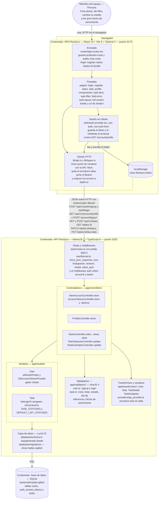

# Arquitectura de FlowSync

Diagrama de contenedores (nivel 2 de C4) dibujado como un flowchart de Mermaid. Muestra las tres piezas que se ejecutan por separado —la SPA de React en el navegador, la API de AdonisJS en `localhost:3333` y el fichero SQLite que le sirve de almacén— y, dentro de cada una, los bloques que hoy existen en el repositorio: las rutas y middlewares de `start/`, los controladores, los validadores de VineJS, los transformers que envuelven toda respuesta en `{ data }`, los modelos de Lucid sobre el esquema generado, y en el frontend el enrutado con sus guards, las pantallas y el único cliente HTTP (`src/lib/api.ts`). Las flechas etiquetan el protocolo real y los endpoints que se llaman de verdad. Todo lo dibujado está verificado leyendo el código: no aparecen colas, caches, servicios externos ni despliegue en producción porque en este repositorio no existen.

